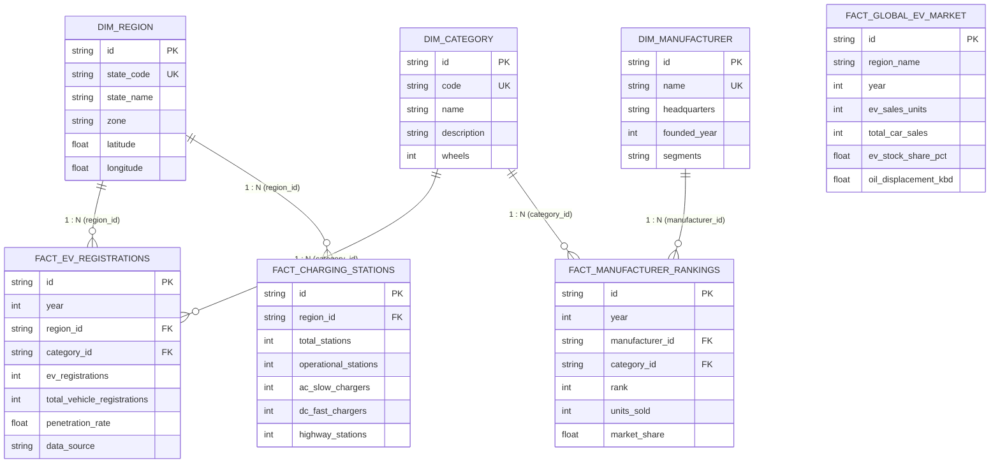

# Power BI Star Schema Data Model Specification
## EV Market Analysis & Business Intelligence

### 1. Architectural Overview
The Power BI analytical data model is built on an industry-standard **Star Schema** architecture optimized for analytical query performance in Microsoft VertiPaq / Power BI Desktop engine. The model separates business entity descriptors (Dimensions) from transactional and observational aggregates (Facts).

---

### 2. Table Specifications & Schema Definitions

#### 2.1 Dimension Tables

##### `DimRegion`
- **Description:** Geographic entity mapping Indian States and Union Territories.
- **Grain:** One row per State / UT.
- **Primary Key:** `id` (`state_code` unique alternate key).
- **Columns:**
  - `id` (Text, PK): UUID / string key (e.g., `reg-mh`).
  - `state_code` (Text, 2-char): Official ISO/RTO abbreviation (e.g., `MH`, `DL`, `KA`).
  - `state_name` (Text): Full state name (e.g., `Maharashtra`, `Delhi`, `Karnataka`).
  - `zone` (Text): Geographic administrative zone (`West`, `North`, `South`, `East`, `Central`).
  - `latitude` (Decimal): Geographic latitude centroid for Power BI Map visuals.
  - `longitude` (Decimal): Geographic longitude centroid for Power BI Map visuals.

##### `DimCategory`
- **Description:** Central Motor Vehicles Rules (CMVR) EV classification.
- **Grain:** One row per vehicle segment.
- **Primary Key:** `id` (`code` unique alternate key).
- **Columns:**
  - `id` (Text, PK): Segment identifier (e.g., `cat-2w`).
  - `code` (Text): Segment code (`2W`, `3W`, `4W`, `BUS`).
  - `name` (Text): Descriptive name (`Two-Wheeler (E-Scooter/Bike)`, `Three-Wheeler (E-Rickshaw/Auto)`).
  - `wheels` (Integer): Number of wheels (2, 3, 4, 6+).

##### `DimManufacturer`
- **Description:** Original Equipment Manufacturers (OEMs) operating in India.
- **Grain:** One row per automotive OEM.
- **Primary Key:** `id` (`name` unique alternate key).
- **Columns:**
  - `id` (Text, PK): OEM identifier (e.g., `mfr-ola`).
  - `name` (Text): Registered company name (`Ola Electric`, `Tata Motors`, `TVS Motor Company`).
  - `headquarters` (Text): Primary city / country of corporate office.
  - `founded_year` (Integer): Year of establishment.
  - `segments` (Text): Operating segments (`2W`, `4W`, `BUS`).

---

#### 2.2 Fact Tables

##### `FactEvRegistrations`
- **Description:** Periodic vehicle registration statistics aggregated from the VAHAN public registry.
- **Grain:** One row per State (`region_id`) per Vehicle Category (`category_id`) per Year (`year`).
- **Primary Key:** `id`.
- **Foreign Keys:**
  - `region_id` references `DimRegion(id)`
  - `category_id` references `DimCategory(id)`
- **Columns:**
  - `year` (Whole Number): Calendar reporting year (2018–2025).
  - `ev_registrations` (Whole Number): Count of officially registered electric vehicles.
  - `total_vehicle_registrations` (Whole Number): Count of all fuel-type vehicle registrations in the same grain.
  - `penetration_rate` (Decimal Percentage): `(ev_registrations / total_vehicle_registrations) * 100`.
  - `data_source` (Text): Provenance tag (`VAHAN Public Dashboard, MoRTH`).

##### `FactManufacturerRankings`
- **Description:** Annual sales volumes and market share rankings by OEM and segment.
- **Grain:** One row per Manufacturer per Category per Year.
- **Foreign Keys:**
  - `manufacturer_id` references `DimManufacturer(id)`
  - `category_id` references `DimCategory(id)`
- **Columns:**
  - `year` (Whole Number): Calendar reporting year.
  - `rank` (Whole Number): Annual sales rank within the segment (1, 2, 3...).
  - `units_sold` (Whole Number): Total EV units registered/sold.
  - `market_share` (Decimal Percentage): Percentage share of the segment volume.

##### `FactChargingStations`
- **Description:** Public EV charging infrastructure distribution sourced from PM E-DRIVE.
- **Grain:** One row per State (`region_id`).
- **Foreign Keys:**
  - `region_id` references `DimRegion(id)`
- **Columns:**
  - `total_stations` (Whole Number): Total sanctioned charging stations.
  - `operational_stations` (Whole Number): Fully commissioned charging stations.
  - `ac_slow_chargers` (Whole Number): Type-2 / Bharat AC-001 slow charger count.
  - `dc_fast_chargers` (Whole Number): CCS2 / CHAdeMO DC fast charger count.
  - `highway_stations` (Whole Number): Stations deployed along National Expressways & Corridors.

##### `FactGlobalEvMarket`
- **Description:** Multi-national EV adoption and energy transition benchmark data from IEA.
- **Grain:** One row per Global Region (`region_name`) per Year.
- **Columns:**
  - `region_name` (Text): Region identifier (`China`, `Europe`, `United States`, `India`, `Rest of World`).
  - `year` (Whole Number): Calendar year (2018–2025).
  - `ev_sales_units` (Whole Number): Electric car sales.
  - `total_car_sales` (Whole Number): Total passenger light-duty vehicle market.
  - `ev_stock_share_pct` (Decimal Percentage): EV share of total in-use vehicle fleet.
  - `oil_displacement_kbd` (Decimal): Barrels of oil displaced per day (in thousands).

---

### 3. Relationships and Cardinalities

| From Table (Many) | Foreign Key | To Table (One) | Primary Key | Cardinality | Cross Filter Direction |
| :--- | :--- | :--- | :--- | :--- | :--- |
| `FactEvRegistrations` | `region_id` | `DimRegion` | `id` | Many to One (*:1) | Single |
| `FactEvRegistrations` | `category_id` | `DimCategory` | `id` | Many to One (*:1) | Single |
| `FactManufacturerRankings` | `manufacturer_id` | `DimManufacturer` | `id` | Many to One (*:1) | Single |
| `FactManufacturerRankings` | `category_id` | `DimCategory` | `id` | Many to One (*:1) | Single |
| `FactChargingStations` | `region_id` | `DimRegion` | `id` | Many to One (*:1) | Single |

---

### 4. Integrity Constraints & Validation Rules
1. **Referential Integrity:** Enforced by SQLite foreign keys and Prisma schema constraints. No fact record may reference an unseeded dimension key.
2. **Grain Uniqueness:** `(year, region_id, category_id)` is enforced as a composite unique index on `FactEvRegistrations`.
3. **Denominator Safety:** All DAX and SQL measures evaluate `DIVIDE(numerator, denominator, 0)` to guarantee zero-division safety.
4. **Data Freshness:** Fact tables contain timestamps and data provenance fields tracing back to official registry snapshots.
